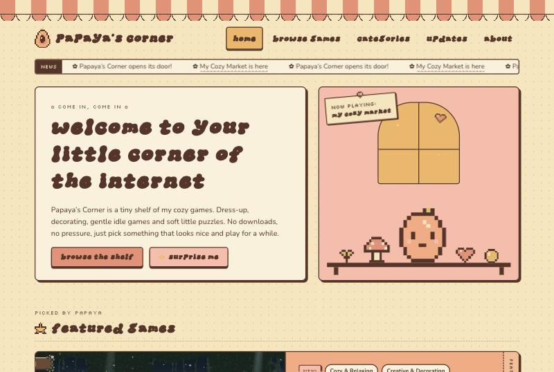
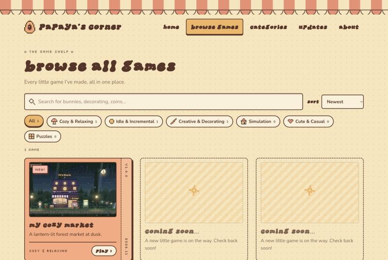
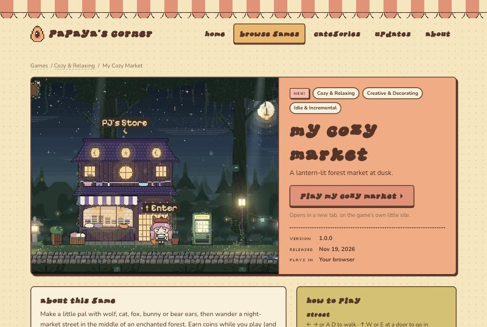

<div align="center">

# 🍈 Papaya's Corner 🍈

### a cozy little corner of the internet for tiny games

Browse, discover and play little cozy games right in your browser.<br>
Dress-up, decorating, gentle idle games and soft little puzzles. No downloads, no pressure.

**[🌸 Visit it here: papayas-corner.vercel.app 🌸](https://papayas-corner.vercel.app)**



</div>

---

## 🌼 What is this?

**Papaya's Corner** is my indie game hub: one cozy home for every little game I make.
It's inspired by the browser game sites I used to spend whole afternoons on, where you could
wander from game to game and always find something new to try.

Pick a mood, find something cute, and play for a while. ♥

---

## 🎮 Games on the shelf

| Game | What it is | Play |
|---|---|---|
| 🐾 **My Cozy Market** | A lantern-lit forest market at dusk. Make a pal, shop, dress up and decorate your home in the woods. | [Play](https://my-cozy-market.vercel.app) · [Code](https://github.com/papayawhip117/Paw-Pal) |
| ✨ *more coming soon!* | | |

---

## ✨ Features

| | |
|---|---|
| 🏠 **Homepage** | A welcome corner, featured games, a "pick a mood" row, the newest games and a corkboard of updates |
| 🔍 **Browse games** | Search, category filters and sorting. Filtered pages have their own links you can share |
| 🗂️ **Categories** | Cozy & Relaxing, Idle & Incremental, Creative & Decorating, Simulation, Cute & Casual, Puzzles |
| 🎟️ **Game pages** | Artwork, description, how to play, a screenshot gallery, patch notes and related games |
| 🕹️ **Play anywhere** | Games can open on their own site or play right on the page |
| 📰 **Updates** | A little news ticker and an updates timeline |
| 💌 **Suggestion box** | Send in game ideas, bug reports or just a hello |
| 🎨 **Pixel details** | Pixel-art decorations, a market awning, gentle hover animations |

<div align="center">




</div>

---

## 🎨 Palette & fonts

| | Color | |
|---|---|---|
| 🟨 | Apricot Cream `#F9E5BB` | page background |
| 🟧 | Papaya `#FCA97E` | game cards, warm panels |
| 🟥 | Coral Blush `#ED8F72` | buttons |
| 🟨 | Golden Hue `#F3B460` | highlights, featured |
| 🟩 | Sun-Soaked `#D9C068` | soft panels, chips |
| 🩷 | Grapefruit `#FFBBA9` | soft panels, "new!" |
| 🟫 | Papaya-seed brown `#5A3326` | text and outlines |

**Gordito Tinta** for headings and buttons, **Nunito** for reading text, **Silkscreen** for tiny pixel labels.

---

## 🧺 Built with

| | |
|---|---|
| ⚛️ [React](https://react.dev) | The site |
| ⚡ [Vite](https://vitejs.dev) | Dev server and build |
| 🧭 [React Router](https://reactrouter.com) | Pages and links |
| ▲ [Vercel](https://vercel.com) | Hosting |

---

## 🛠️ Run it yourself

You'll need [Node.js](https://nodejs.org) installed.

```bash
git clone https://github.com/papayawhip117/Papayas-Corner.git
cd Papayas-Corner
npm install
npm run dev
```

Then open the link Vite prints (usually http://localhost:5173). 🎉

| Command | What it does |
|---|---|
| `npm run dev` | Start the site locally with hot reload |
| `npm run build` | Build the site into `dist/` |
| `npm run preview` | Preview the built site |

---

## ➕ Adding a game

1. Put its images in `public/games/<slug>/` (a cover and any screenshots).
2. Open `src/data/games.js`, copy the template at the bottom and fill it in.
3. That's it! It shows up in Browse, Categories and search, and gets its own page at `/games/<slug>`.

- `play: { type: 'external', url }` opens the game on its own site.
- `play: { type: 'embed', url, aspect: '16 / 9' }` plays it right on the page.
  For a game hosted here, put its built files in `public/play/<slug>/` and use `url: '/play/<slug>/index.html'`.
- No cover yet? Leave it out and a pixel cover is drawn for you.
- `status` can be `new`, `featured`, `coming-soon` or `released`. `featured: true` puts it on the homepage.

### 🗂️ Where things live

```
src/
  data/        games, categories, updates and site settings (socials, email)
  components/  header, footer, game cards, pixel art, suggestion box
  pages/       home, browse, categories, game page, updates, about
  styles/      the palette and all the styling
public/
  fonts/       Gordito Tinta
  games/       game covers and screenshots
```

---

## 🗺️ Roadmap

- [x] Homepage, browse, categories and game pages
- [x] My Cozy Market on the shelf
- [x] Suggestion box
- [ ] 🎮 More little games!
- [ ] 🖼️ Games that play right on the page
- [ ] 🔗 More socials

---

<div align="center">

💌 Say hi on Instagram: **[@papayawhip.dev](https://www.instagram.com/papayawhip.dev/)**

</div>
